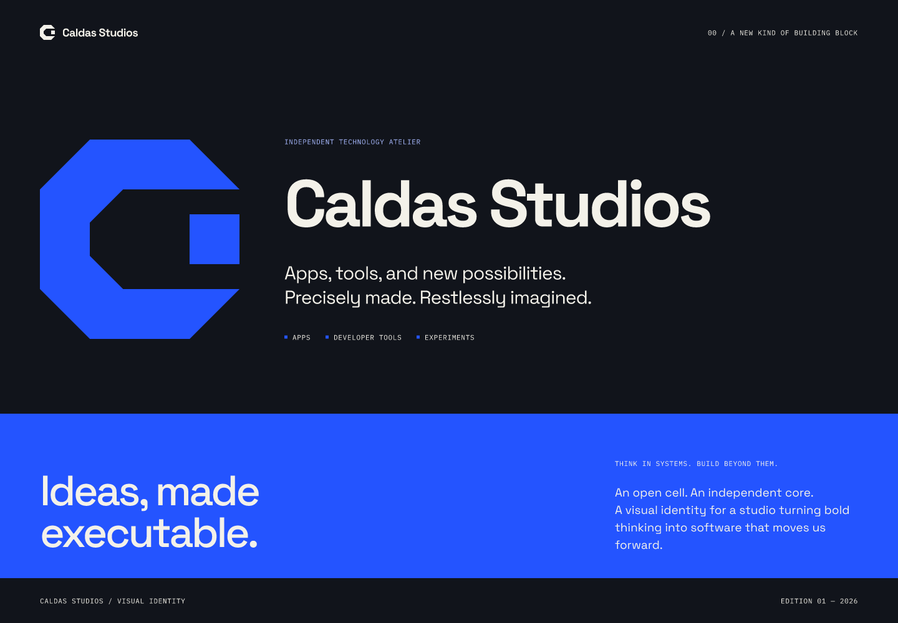
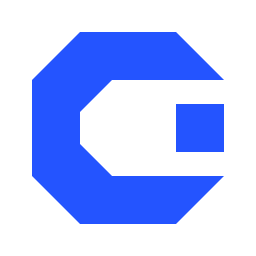
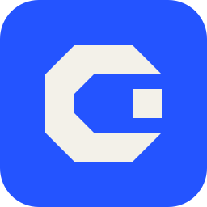
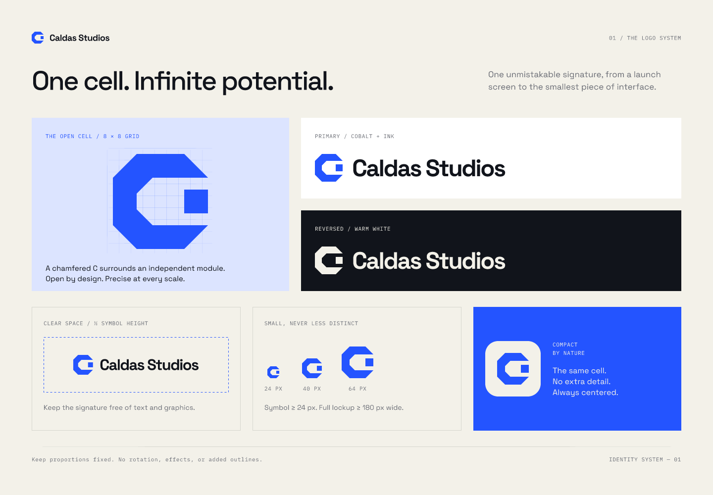
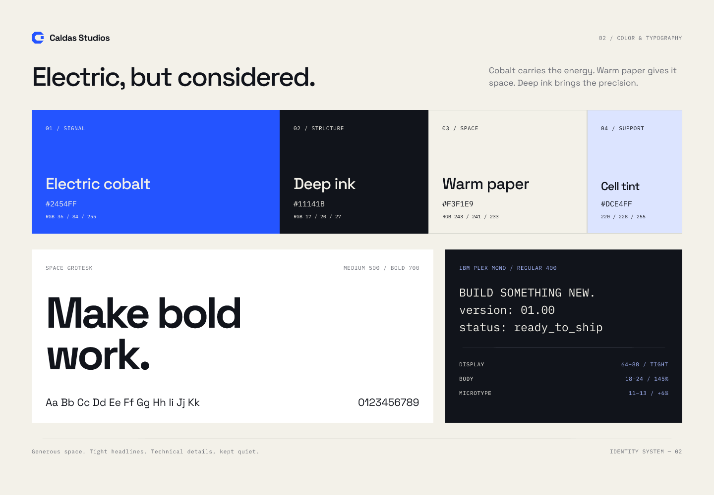
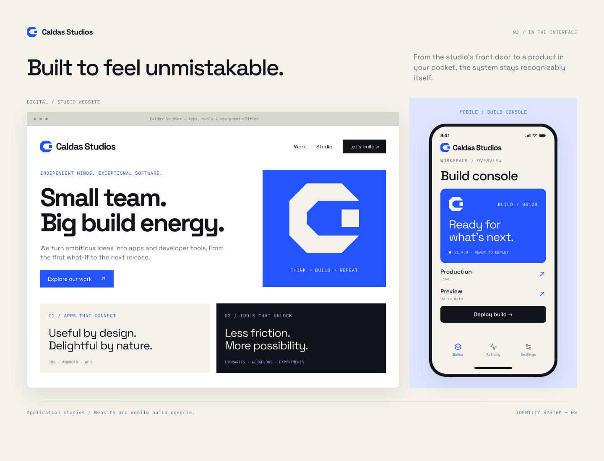
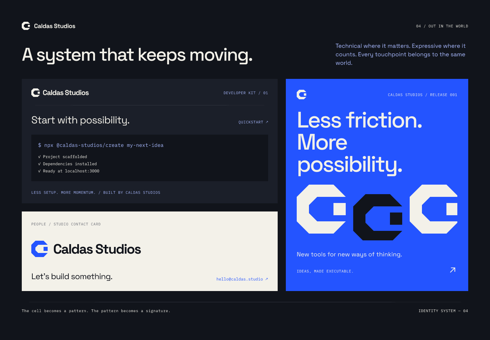

<p align="center">
  <picture>
    <source media="(prefers-color-scheme: dark)" srcset="assets/logos/caldas-studios-reversed.svg">
    
  </picture>
</p>

<p align="center">
  <strong>Ideas, made executable.</strong><br>
  Identidade visual e assets da Caldas Studios, prontos para usar.
</p>

<p align="center">
  <a href="#assets">Assets</a> ·
  <a href="#cores">Cores</a> ·
  <a href="#tipografia">Tipografia</a> ·
  <a href="#uso-da-marca">Uso da marca</a> ·
  <a href="#pranchas-da-identidade">Pranchas</a> ·
  <a href="#atualizar-os-assets">Atualização</a>
</p>



## Sobre este repositório

Esta é a base de assets da [CaldasStudios](https://github.com/CaldasStudios). Aqui você encontra os logos, o símbolo, o ícone de app e as referências visuais da marca, sem precisar abrir o arquivo de design.

O [CaldasStudio-Brand.figcraft](CaldasStudio-Brand.figcraft) é a **fonte editável**. Os arquivos em `assets/` são exportações para uso; as imagens em `docs/brand/` documentam a identidade e suas aplicações.

## Assets

### Logos

| Versão | Composição e uso | SVG | PNG transparente |
| --- | --- | --- | --- |
| **Principal** | Símbolo em Electric cobalt e nome em Deep ink. Para fundos claros. | [Abrir SVG](assets/logos/caldas-studios-primary.svg) | [Abrir PNG](assets/logos/caldas-studios-primary.png) |
| **Reverso** | Símbolo e nome em Warm paper. Para fundos escuros. | [Abrir SVG](assets/logos/caldas-studios-reversed.svg) | [Abrir PNG](assets/logos/caldas-studios-reversed.png) |

Os dois PNGs têm **1460 × 224 px**. As assinaturas foram exportadas sem o fundo da prancha e com recorte no conteúdo; adicione a área de proteção ao posicioná-las.

> O logo reverso é claro e transparente. Visualize-o sobre um fundo escuro para enxergar a assinatura.

### Símbolo e ícone de app

<table>
  <tr>
    <th>Símbolo</th>
    <th>Ícone de app</th>
  </tr>
  <tr>
    <td align="center"></td>
    <td align="center"></td>
  </tr>
  <tr>
    <td align="center"><a href="assets/icons/caldas-studios-symbol.svg">SVG</a> · <a href="assets/icons/caldas-studios-symbol.png">PNG</a></td>
    <td align="center"><a href="assets/icons/caldas-studios-app-icon.svg">SVG</a> · <a href="assets/icons/caldas-studios-app-icon.png">PNG</a></td>
  </tr>
</table>

- **Símbolo:** versão isolada em Electric cobalt, com fundo transparente. Para avatares, interfaces e espaços onde o nome já esteja identificado.
- **Ícone de app:** símbolo em Warm paper sobre uma base azul com cantos arredondados. Mantém a composição do arquivo fonte, incluindo transparência nos cantos externos.
- **Tamanhos:** os SVGs usam uma área de `256 × 256`; os PNGs têm **1024 × 1024 px**.

### Qual formato escolher?

- **SVG:** preferencial para web, interfaces e layouts que precisam escalar. As letras estão convertidas em curvas; não é necessário instalar fontes para exibir os logos.
- **PNG:** para ferramentas que não aceitam SVG, apresentações e materiais rasterizados. Preserve a proporção e evite ampliar além da resolução exportada.
- **Arquivo `.figcraft`:** para editar a identidade e preparar novas exportações.

## Cores

Paleta principal, conforme a prancha de cores e tipografia. Os exports usam **sRGB**.

| Cor | HEX | RGB | Papel na identidade |
| --- | --- | --- | --- |
| **Electric cobalt** | `#2454FF` | `36, 84, 255` | Cor de destaque e energia da marca. |
| **Deep ink** | `#11141B` | `17, 20, 27` | Textos escuros, estrutura e fundos escuros. |
| **Warm paper** | `#F3F1E9` | `243, 241, 233` | Fundos claros e assinatura reversa. |
| **Cell tint** | `#DCE4FF` | `220, 228, 255` | Superfícies suaves de apoio. |

Nas aplicações também aparecem `#6B6E76` para textos secundários e `#A8B9FF` para detalhes claros sobre fundos escuros.

Use a prancha como referência de composição, não como garantia de contraste para qualquer combinação. Em interfaces, verifique o contraste do texto no tamanho e no fundo escolhidos.

## Tipografia

| Família | Pesos indicados na prancha | Uso |
| --- | --- | --- |
| **[Space Grotesk](https://fonts.google.com/specimen/Space+Grotesk)** | Medium `500` e Bold `700` | Títulos, mensagens principais e texto de interface. |
| **[IBM Plex Mono](https://fonts.google.com/specimen/IBM+Plex+Mono)** | Regular `400` | Rótulos, metadados, código e detalhes técnicos. |

Referências de escala presentes na identidade:

- **Display:** 64–88 px, com espaçamento compacto.
- **Corpo:** 18–24 px, com entrelinha de 145%.
- **Microtexto:** 11–13 px, com espaçamento entre letras de +6%.

Esses valores descrevem as pranchas, não uma regra universal para todas as telas. Ajuste a escala para preservar a leitura, especialmente no mobile.

As fontes não estão incluídas neste repositório. Obtenha-as nas páginas acima e consulte as respectivas licenças ao incorporá-las a um projeto.

## Uso da marca

O símbolo é uma célula aberta: um **C chanfrado em uma grade de 8 × 8**, envolvendo um módulo independente.

Regras registradas na prancha do sistema de logos:

1. **Área de proteção:** mantenha ao redor da assinatura pelo menos metade da altura do símbolo, livre de texto e elementos gráficos.
2. **Tamanho mínimo:** símbolo com pelo menos **24 px** de altura; assinatura completa com pelo menos **180 px** de largura.
3. **Proporção fixa:** não estique, comprima, gire ou altere a relação entre símbolo e nome.
4. **Sem efeitos adicionais:** não acrescente contornos, sombras ou outros efeitos ao logo.
5. **Fundo adequado:** use a assinatura principal em fundos claros e a reversa em fundos escuros, preservando a legibilidade.



## Pranchas da identidade

As cinco pranchas estão disponíveis em PNG, na resolução original dos frames.

| Prancha | Conteúdo | Dimensões |
| --- | --- | --- |
| [00 · Brand identity](docs/brand/00-brand-identity.png) | Apresentação da marca, assinatura e linguagem visual. | 1440 × 1000 px |
| [01 · Logo system](docs/brand/01-logo-system.png) | Construção do símbolo, versões e regras de uso. | 1440 × 1000 px |
| [02 · Color and typography](docs/brand/02-color-and-typography.png) | Paleta, famílias tipográficas e hierarquia. | 1440 × 1000 px |
| [03 · Digital applications](docs/brand/03-digital-applications.png) | Estudos de aplicação em website e interface mobile. | 1440 × 1100 px |
| [04 · Studio applications](docs/brand/04-studio-applications.png) | Estudos de developer kit, cartão de contato e peça de divulgação. | 1440 × 1000 px |

> **Aplicações conceituais:** as telas, os comandos, os contatos e os materiais apresentados nas pranchas são exemplos visuais. Não comprovam a existência de um produto, pacote publicado ou canal de contato ativo.

<details>
  <summary><strong>Ver cores e tipografia</strong></summary>

  

</details>

<details>
  <summary><strong>Ver aplicações digitais</strong></summary>

  

</details>

<details>
  <summary><strong>Ver aplicações do estúdio</strong></summary>

  

</details>

## Estrutura

```text
.
├── CaldasStudio-Brand.figcraft        # Fonte editável da identidade
├── README.md                         # Catálogo e orientações de uso
├── assets/
│   ├── icons/                        # Símbolo e ícone de app: SVG + PNG
│   └── logos/                        # Assinaturas principal e reversa: SVG + PNG
└── docs/
    └── brand/                        # Cinco pranchas de referência em PNG
```

## Atualizar os assets

1. Abra o [arquivo fonte](CaldasStudio-Brand.figcraft) no FigCraft e faça as alterações necessárias.
2. Exporte os elementos correspondentes, mantendo os nomes e os caminhos deste repositório:

   | Arquivo de destino, sem extensão | Origem no documento | Exportação |
   | --- | --- | --- |
   | `assets/logos/caldas-studios-primary` | Grupo da assinatura dentro de **Primary logo asset**, sem o frame externo. | SVG e PNG em 2×. |
   | `assets/logos/caldas-studios-reversed` | Grupo da assinatura dentro de **Reversed logo asset**, sem o retângulo escuro de fundo. | SVG e PNG em 2×. |
   | `assets/icons/caldas-studios-symbol` | Frame **Symbol asset** completo. | SVG e PNG com largura de 1024 px. |
   | `assets/icons/caldas-studios-app-icon` | Frame **App icon asset** completo. | SVG e PNG com largura de 1024 px. |
   | `docs/brand/00` a `04` | Frames de identidade, logos, cores e aplicações listados acima. | PNG em 1×, mantendo os nomes completos existentes. |

3. Nos SVGs, mantenha o texto em curvas. Nos logos, preserve a transparência; no ícone de app, preserve a base azul.
4. Confira os PNGs e SVGs em fundos claros e escuros, verificando cores, recorte e proporções. Se a geometria mudar, atualize as dimensões documentadas aqui.
5. Salve o `.figcraft` e atualize as exportações e este README juntos, para não deixar versões divergentes.

Não há build ou dependências para consumir os assets. As exportações são manuais; editar o `.figcraft` não atualiza os demais arquivos automaticamente.

## Permissão de uso

Este repositório reúne os elementos de identidade da Caldas Studios. A disponibilidade dos arquivos não concede, por si só, licença de uso da marca ou de redistribuição. Para usos externos, confirme a autorização com a organização.
